<picture>
  <source media="(prefers-color-scheme: dark)" srcset="fastfetch/dark.svg">
  <source media="(prefers-color-scheme: light)" srcset="fastfetch/light.svg">
  
</picture>

  <a href="https://linktr.ee/0xbahaa"><picture>
    <source media="(prefers-color-scheme: dark)" srcset="fastfetch/btn-linktree-dark.svg">
    <source media="(prefers-color-scheme: light)" srcset="fastfetch/btn-linktree-light.svg">
    
  </picture></a>
  <a href="https://linkedin.com/in/0xbahaa"><picture>
    <source media="(prefers-color-scheme: dark)" srcset="fastfetch/btn-linkedin-dark.svg">
    <source media="(prefers-color-scheme: light)" srcset="fastfetch/btn-linkedin-light.svg">
    
  </picture></a>

